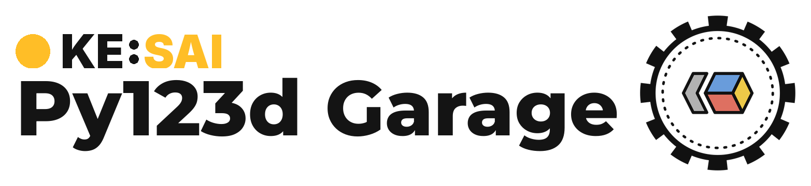

<div align="center">

<picture>
  <source media="(prefers-color-scheme: dark)" srcset="../assets/logo_dark.png">
  
</picture>

</div>

<h1 align="center">Alpasim evaluation</h1>

Alpasim is NVIDIA's closed-loop simulator. It comes as its own Python project with its own environment, so evaluating there works the other way round from the rest of this repository: we set up the Alpasim environment and install py123d_garage into it as a dependency.

At evaluation time the garage plays only one role, the driver. Alpasim splits a simulation into services: rendering the sensors, simulating the traffic, scoring, and the driver, which receives the sensor data and returns the trajectory to follow. The garage implements that driver as a small server around a checkpoint. Everything else is handled by the Alpasim wizard, which starts the remaining services in Docker, connects them to our driver, and writes the scores.

## Setup

Needs Docker with the NVIDIA runtime, `uv`, and a Hugging Face token with access to [PhysicalAI-Autonomous-Vehicles-NuRec](https://huggingface.co/datasets/nvidia/PhysicalAI-Autonomous-Vehicles-NuRec) for the scene downloads.

```bash
lib/alpasim/tools/setup_alpasim.sh
export HF_TOKEN=<token>
```

The script clones the `e2e_challenge` branch of [NVlabs/alpasim](https://github.com/NVlabs/alpasim/tree/e2e_challenge) at a pinned commit into `lib/alpasim/alpasim` (gitignored), syncs its venv and installs `py123d_garage` into its venv. Every Alpasim command below runs from that venv.

## Important files

| Path                                               | What it is                                                                                                                                             |
| -------------------------------------------------- | ------------------------------------------------------------------------------------------------------------------------------------------------------ |
| `lib/alpasim/tools/setup_alpasim.sh`               | Sets up the Alpasim checkout, see above                                                                                                                |
| `lib/alpasim/tools/submission.Dockerfile`          | Image for the challenge submission                                                                                                                     |
| `src/py123d_garage/evaluation/alpasim/evaluate.py` | The driver                                                                                                                                             |
| `src/py123d_garage/evaluation/alpasim/configs/`    | Hydra configs that tell the wizard about our driver: which cameras it wants (`driver`), where it listens (`driver_source`), the nuPlan rig (`cameras`) |
| `lib/alpasim/tools/submission_qwendrive_pi.Dockerfile` | Image for the challenge submission of a starVLA QwenDrivePI checkpoint, see below |

## Local evaluation

To get familiar with Alpasim, read [its documentation](https://github.com/NVlabs/alpasim/tree/e2e_challenge/docs) first. Py123D Garage provides only the driver.

### Physical AI AV Track

We provide an small script to start the py123d_garage's driver and evaluate small scenes locally.

```bash
CHECKPOINT_FILE=<checkpoint.pth> scripts/evaluation/alpasim/latent_transfuser.sh
```

### nuPlan track

The nuPlan track renders with MTGS. Download the trajdata cache, the scene configs and the asset shards. Then drive:

```bash
ALPASIM_NUPLAN_ROOT=<mtgs root> CHECKPOINT_FILE=<checkpoint.pth> scripts/evaluation/alpasim/latent_transfuser_nuplan.sh
```

## Challenge submission

Register at the [challenge space](https://huggingface.co/spaces/nvidia/AlpasimE2EClosedLoopChallenge2026), then run the steps in order:

```bash
scripts/alpasim_submission/login_challenge.sh
scripts/alpasim_submission/build_docker_image.sh
scripts/alpasim_submission/smoke_test_image.sh
scripts/alpasim_submission/submit_image.sh
```

## starVLA QwenDrivePI

`QwenDrivePIPolicy` (`src/py123d_garage/policy/qwendrive_pi/`) drives with a starVLA QwenDrivePI checkpoint trained on PAI-AV (`lib/starVLA/examples/drive/PAI-AV`). It reads what the training loader read: the front wide camera at t0 - 0.1 s and t0, resized to the training token grid, the ego speed, acceleration, angular velocity and heading at 10 Hz over the last 0.4 s, and the target point 25 m ahead on the route. It predicts 2.5 s of waypoints.

Qwen3.5 needs transformers 5, while the Alpasim venv pins transformers 4, so the driver never runs from the Alpasim venv: it runs from the submission image or from its own venv.

First bundle a checkpoint. The bundle links the step's `model.safetensors`, `config.yaml` (as `starvla_config.yaml`) and `norm_stats.json`, and downloads the config, tokenizer and processor files of the base VLM, but not its weights:

```bash
RUN_DIR=outputs/qwendrive_pi/qdpi_paiav_12ep_h25 scripts/pretrained/qwendrive_pi.sh
```

Then build the image, smoke-test it against the challenge preset and submit it:

```bash
scripts/alpasim_submission/login_challenge.sh
BUNDLE_DIR=outputs/checkpoints/qwendrive_pi/qdpi_paiav_12ep_h25 scripts/alpasim_submission/build_qwendrive_pi_image.sh
TAG=qwendrive-pi scripts/alpasim_submission/smoke_test_image.sh
TAG=qwendrive-pi VERSION=v1 scripts/alpasim_submission/submit_image.sh
```

`smoke_test_image.sh` runs the driver container under the challenge sandbox: read-only root, 2 GiB `/tmp`, no capabilities, 32 GiB of memory and 8 CPUs. `SANDBOX=0` turns the sandbox off and `GPUS=device=1` pins the GPU. To iterate without rebuilding the image, `lib/alpasim/tools/setup_qwendrive_pi_venv.sh` creates `lib/alpasim/qwendrive_pi_venv` with the image's packages, and `scripts/evaluation/alpasim/qwendrive_pi.sh` runs the same preset with the driver on the host.

Speed. The challenge targets 0.1 s of model work per `Drive` call. One plan takes about 140 ms on an H200: about 15 ms for the processor, 75 ms for the VLM and 40 ms for the flow-matching expert, whose 10 denoising steps replay from one CUDA graph. The policy therefore replans every fifth 100 ms tick, every 0.5 s, and serves the cached plan in between (`qwendrive_pi_config.replan_every_n_intervals`). The challenge's EC2 preset runs two rollouts per driver, whose plans queue on one GPU, so the mean `Drive` call stays under 0.1 s for plans up to 0.25 s. The driver records the ego state on every tick, so the 10 Hz history stays complete between plans. Warmup captures one expert graph per prompt length, which the speed and target point digits of the v2 runs vary, so no capture stalls a rollout; AnchorVLA's query bias replays from the same graphs. One driver uses about 11.6 GiB of VRAM, within the 16 GiB per instance.

v2 runs (`state_mode: traj`, `action_mode: unicycle`, the speed and target point in the prompt) and AnchorVLA v2 runs are served by the same policy, read from the run config. The bundle script copies an AnchorVLA run's anchor codebook (`framework.anchor.path`, found next to the run directory or given by `ANCHORS`) into the bundle. `DRIVER_ARGS="visualization_interval=1"` on `smoke_test_image.sh` or `scripts/evaluation/alpasim/qwendrive_pi.sh` writes a real-time drive video per rollout into `<OUTPUT_DIR>/driver/views`: the current frame next to a BEV of the planned waypoints, the ego history, the target point and the anchor reference.

Linear attention. Qwen3.5's linear-attention layers run flash-linear-attention's Triton kernels, which are compiled at startup into `/tmp`. If they fail to compile or load, for example because `/tmp` is mounted noexec, the policy falls back to transformers' torch implementation, which is about 50 ms slower per plan, and logs it. `qwendrive_pi_config.linear_attention_kernels` (`auto`, `fla`, `torch`) forces either one.
